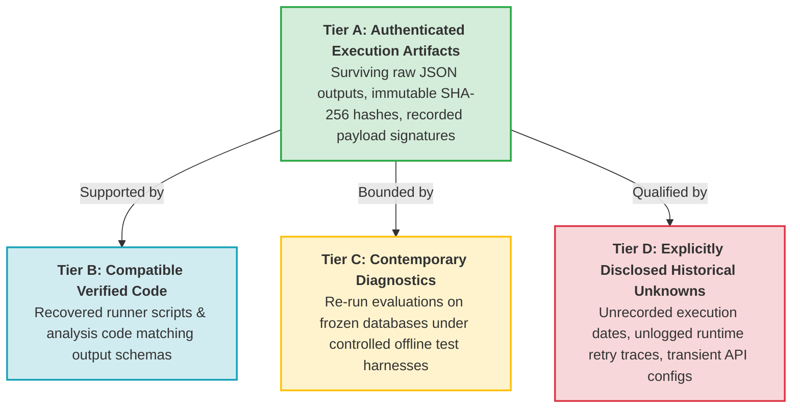
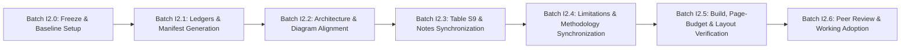

# I2 Implementation Plan: Historical Provenance, Execution Lineage, and Architecture Alignment

Prepared by Antigravity, 25 October 2026, Asia/Dhaka.  
In response to Codex-0326 (`coordination/terra_antigravity/codex_to_antigravity/20261025-codex-0326-i2-implementation-plan-request.md`).

**Status: Implementation plan only.** Antigravity's role is planning and read-only evidence inspection. Codex will audit this plan and execute the approved batches. This document defines the operational execution of **Milestone I2** under [`20261008_REVIEWER_INTEGRATED_SUBMISSION_PLAN.md`](file:///F:/TERRA%20-Copy/TERRA_EDITORIAL_RESTART_V2/plans/20261008_REVIEWER_INTEGRATED_SUBMISSION_PLAN.md).

---

## 1. Executive Summary & Baseline Authority

The objective of Milestone I2 is to **pin every historical and prospective experiment to its authoritative evidence**, resolve architecture-to-evidence accounting gaps across the manuscript and diagrams, and establish transparent, permanent provenance disclosures without fabricating missing history.

### 1.1 Baseline Authority & Working Tree State
- **Active Working Sources:** [`TERRA_EDITORIAL_RESTART_V2/working/src/`](file:///F:/TERRA%20-Copy/TERRA_EDITORIAL_RESTART_V2/working/src/), verified 46/46 files byte-identical to the accepted I7 baseline (`reviewer_I7_20261025_01/adoption_20261025_01/working_after_manifest.json`).
- **Active Manuscript Builds:** 
  - `main.pdf`: Exactly **25 pages** including complete references (SHA-256 `52211c53a6ea9e1e1ca82d741c30d253d52d5a3a9527491fb7c9e7c5629a844e`), strictly meeting the advisor ceiling.
  - `TERRA_SUPPLEMENT.pdf`: Exactly **18 pages** (SHA-256 `24618b659c28bc3a589f81d13db1b608fcba49b8004fcf12217c09c26ea6143c`).
- **Springer Candidate I9:** Formally **SET ASIDE** by user directive. No Springer formatting changes, class files, or single-column reflows will be imported or referenced during I2.
- **Roadmap Position:** Current verified state is **6 Complete, 4 Partial, 3 Pending**. Milestone I2 is currently **Partial**; successful execution of this plan advances I2 to **Complete (DONE)**.

### 1.2 Boundary Conditions
- **No Experimental Execution or API Calls:** No live model queries, embeddings generation, API calls, database modifications, or parameter re-tuning.
- **No Statistics Alteration:** Historical scores, macro values (`generated_stats.tex`, `generated_obscure_stats.tex`, `generated_corpus_stats_20k.tex`), and prospective matched-study data remain byte-frozen.
- **No Unapproved Object Moves:** All table and figure placements remain in their active documents.
- **Strict Page Budget:** The main paper must not exceed **25 pages**; supplement must remain at **18 pages**.

---

## 2. Gap Analysis & Reconciliation of Existing Work

A rigorous audit of prior provenance work (`experiment_provenance_20261012_01/`, `provenance_disclosure_20261012_01/`, I7 dispositions, and `reports/matched_study_r03_20261025_01/`) establishes the following reconciliation:

### 2.1 Settled & Verified Facts (Do Not Re-litigate)
1. **Prospective Matched Study Separation:** The 350-pair matched study executed on 25 October 2026 is an independent prospective study on the corrected 145,363-edge graph derivative. It is fully evidenced (`reports/matched_study_r03_20261025_01/`) and partitioned from the historical 5-system benchmark.
2. **Graph Attribution Partition:** Historical runs (canonical-v2, pilot, obscure, CaseFacts, CLERC, temporal update) operated on the original 145,366-edge graph ($145{,}310$ citation edges + $56$ overruling edges). The prospective study operated on the 145,363-edge graph ($145{,}310$ citation edges + $53$ valid overruling edges, excluding *Edelman*, *Griffin*, *Hensley*). Historical runs must not be retroactively reassigned.
3. **Temporal Leakage Probe Missingness:** 315 complete dual-judge pairs and 85 missing GPT-OSS evaluations are documented; the unsupported "manual spot-check" claim has been completely excised.
4. **Distance Gate Ex-Post Character:** The squared-$L_2$ threshold ($\tau = 1.30$, $\text{AUROC} = 0.9901$ across 20k cases) was an offline diagnostic; zero canonical benchmark queries were terminated prior to retrieval at runtime.

### 2.2 Reconciled Errata & Superseded Records
1. **AUROC Typo:** Antigravity-0303's draft summary text cited 0.9416 (from an intermediate calibration subset); the verified index-wide AUROC is **0.9901**, correctly reflected in macro and text.
2. **Active Label Multiplicities:** Historical references to "79 references in main.bbl" were an erratum conflating document label count (79 active labels) with compiled bibliography items (exactly 30 items in `main.bbl`).
3. **Directed Graph Edges:** Corrected nomenclature from "citation edges" to "directed graph edges" ($145{,}366$) to accurately reflect the union of citation and overruling edges.

### 2.3 Genuinely Open Gaps Requiring I2 Resolution
1. **Configuration vs. Code Discrepancy:**
   - `configs/terra_config.json` declares `hub_degree_cap = 50`.
   - `ask_terra.py:518–519` implements `incoming = 75` and `outgoing = 25` (total 100 directional budget), with visited-node cap 40 and structural character limit 35,000.
   - *Resolution:* Manuscript text and Table S9 notes must explicitly disclose that `configs/terra_config.json` reflects an early design snapshot, whereas surviving runner code implemented the 75/25 directional budget and 40-node/35k-character operational bounds.
2. **Architecture Diagram (Figure 1) Evidentiary Alignment:**
   - *Fast Path Labeling:* Figure 1 node must read "Grounded Fast Path (EASY)" with explicit note: "Anchor Retrieval (No Graph Expansion)", eliminating any ambiguous "No RAG" or ungrounded bypass implication.
   - *Self-Correction / Expansion Loop:* Figure 1 displays a "Self-Correction Loop: $n_{\text{results}} += 2$ (Max 2 Attempts)". While this mechanism exists in `ask_terra.py`, historical benchmark records (`data/terra_canonical_v2_eval.json`) do not log intermediate retry invocations.
   - *Resolution:* Retain the diagram block as an accurate depiction of the implemented engine architecture, but add an explicit caveat in the caption and Section III-C stating that while the iterative expansion loop is fully implemented in code, per-attempt retry transitions were not recorded in the historical 350-query benchmark logs.
3. **Table S9 (Run Provenance) Granularity:**
   - Table S9 in `supplement_tables/table_run_provenance.tex` currently lists 11 rows. Several distinct experimental populations (canonical vs. legacy sensitivity, bounded traversal diagnostics, temporal update stability, 20k topology) are conflated in table footnotes rather than given structured matrix representation.
   - *Resolution:* Reconcile Table S9 and its extensive notes against the 16-experiment matrix below.

---

## 3. Complete 16-Experiment Provenance Matrix

Every experiment reported in the manuscript is itemized below with its exact population, evidence artifact, hashes, graph semantics, model settings, and provenance status:

| Exp ID | Experiment Name & Population | Evidence Artifact & SHA-256 | Graph & Edge Semantics | Vector Index & Embedding | Code & Config Evidence | Retrieval Limits & Serialization | Generator, Verifier, Router & Judges | Execution Date & Time Evidence | Provenance Status & Disposal |
|---|---|---|---|---|---|---|---|---|---|
| **E01** | **Historical TERRA Benchmark** ($N=350$ queries across Cats A–D) | `data/terra_canonical_v2_eval.json` `95e775e2...` | Original EEG ($|V|=20\text{k}$, $\|E\|=145{,}366$; 145,310 cites + 56 overrules) | ChromaDB index; `all-MiniLM-L6-v2` | `ask_terra.py` (recovered); `configs/terra_config.json` | $k=2$ anchors; 2-hop BFS ($d=2$); hub cap 75/25; 40 nodes / 35k chars | Router: `gemma-3-12b`; Gen: `llama-3.3-70b-instruct` ($T=0.0$); J1: `qwen3-next-80b`, J2: `gpt-oss-120b` | 14 Sept 2026 (`file mtime`); run tag `issue6_deployed` | **Tier A (Authenticated Output)**; exact historical commit unlogged; config discrepancy disclosed. |
| **E02** | **Historical Comparative Baselines** ($N=1{,}400$ runs across 4 systems) | `data/terra_canonical_v2_eval.json` `95e775e2...` | Direct: none; Flat: none; GraphRAG/HippoRAG: 145,366 edges | ChromaDB index; `all-MiniLM-L6-v2` | `scripts/baselines/` adapters | Flat: top-$k=5$; GraphRAG: Leiden/modularity; Hippo: PPR on graph | Gen: `llama-3.3-70b-instruct`; no router/NLI; Judges J1/J2 identical to E01 | 5–6 Sept 2026 (`file mtime`); run tag `sept6_baseline_rejudged` | **Tier A (Authenticated Output)**; per-arm historical run scripts preserved in baseline archive. |
| **E03** | **Prospective Paired Matched Study** ($N=350$ pairs, 700 arm outcomes) | `reports/matched_study_r03_20261025_01/` `489485c0...` | Corrected EEG ($|V|=20\text{k}$, $\|E\|=145{,}363$; 53 overrules) | ChromaDB (`chroma_store_20k`); `all-MiniLM-L6-v2` | `scripts/matched_baseline/` (frozen runner & contracts) | Pinned 4,096-token budget via `tiktoken`/o200k; identical serialized context | Router: Gemma 3 12B; Verifier/Gen: Llama 3.3 70B; Judges: Qwen3-Next & GPT-OSS | 25 Oct 2026 (exact execution timestamps in JSON) | **Tier A (Fully Authenticated Prospective Study)**; shared pipeline controls; verifier refusal asymmetry documented. |
| **E04** | **Component-Level Ablation Study** ($N=35$ queries $\times$ 4 arms $\times$ 5 repeats = 700 obs) | `provenance_disclosure_20261012_01/IMPLEMENTATION_REPORT.md` `0e0180a3...` | Original EEG (145,366 edges) | ChromaDB index; `all-MiniLM-L6-v2` | Ablation harness; single-judge evaluator | No-NLI, No-Graph, No-Scaffold, Full TERRA arms | Single evaluator: `meta-llama-3.3-70b-instruct` (recorded endpoint); no dual judges | Date unrecorded in source; historical Llama evaluator | **Tier A (Authenticated Observations)**; date unrecorded; single-judge protocol disclosed. |
| **E05** | **Canonical-v2 Traversal Sensitivity** ($N=100$ Cat B queries) | `reviewer_I1b_20261008/stored_context_recount.json` `57fee83a...` | Original EEG (145,366 edges) | ChromaDB index; `all-MiniLM-L6-v2` | `ask_terra.py` traversal logic | 2-hop BFS; unconstrained legacy vs canonical | 66/100 complete landmark chain recoveries | Canonical evaluation run records | **Tier A (Authenticated Contexts)**; 66/100 count verified against stored context subgraphs. |
| **E06** | **Legacy Traversal Sensitivity** ($N=100$ Cat B queries) | `reviewer_I1b_20261008/stored_context_recount.json` `57fee83a...` | Original EEG (145,366 edges) | ChromaDB index; `all-MiniLM-L6-v2` | Legacy traversal script | 2-hop BFS; earlier anchor formulation | 62/100 complete landmark chain recoveries | Legacy evaluation run records | **Tier A (Authenticated Contexts)**; 62/100 count verified; distinct from canonical 66/100. |
| **E07** | **Contemporary Bounded Traversal Diagnostic** ($N=100$ Cat B queries) | `reviewer_I1b_20261008/I1B_REPORT.md` `fddceced...` | Original EEG (145,366 edges) | ChromaDB index; `all-MiniLM-L6-v2` | Re-run harness with strict 35k char / 40 node limits | Strict operational caps enforced | 61/100 complete landmark chain recoveries | 8 Oct 2026 (contemporary diagnostic) | **Tier C (Contemporary Diagnostic)**; executed to bound operational cap impact; not historical run. |
| **E08** | **Obscure Precedent Overruling Suite** ($N=30$ queries $\times$ 4 arms = 120 obs) | `scratch/obscure_raw_responses.json` `7fa2b6e1...` | Original EEG (145,366 edges) | ChromaDB fingerprint recorded | Engine hash `430fc1b3...`; `temperature=0.0`, `max_tokens=4096` | 4 comparative pipelines; oracle precedent seeding | Gen: `meta-llama-3.3-70b-instruct-121024` (60) / `databricks-...` (54) / None (6); J1/J2 | 19–20 Sept 2026 (`file mtime`) | **Tier A (Authenticated Recorded Output)**; engine hash verified; generator serving aliases disclosed. |
| **E09** | **Famous Landmark Precedent D1 Contrast** ($N=19$ queries $\times$ 4 arms = 76 obs) | `scratch/famous_d1_raw_responses.json` `cb37e908...` | Original EEG (145,366 edges) | ChromaDB fingerprint recorded | Same engine hash `430fc1b3...`; `temperature=0.0`, `max_tokens=4096` | 4 comparative pipelines; famous landmark seeds | Gen: `meta-llama-3.3-70b-instruct-121024` (38) / `databricks-...` (31) / None (7); J1/J2 | 19–20 Sept 2026 (`file mtime`) | **Tier A (Authenticated Recorded Output)**; subset contrast (19 queries), not full 75 Cat D. |
| **E10** | **CaseFacts External Fact-Checking** ($N=170$ queries: 120 fact + 50 refusal $\times$ 3 arms = 510 obs) | `scratch/casefacts_120_eval_raw.json` `scratch/casefacts_50_refusal_eval_raw.json` | Original EEG (145,366 edges) | ChromaDB index; `all-MiniLM-L6-v2` | `compute_casefacts_metrics.py` | 3 arms: Direct, Flat, TERRA | Dual judges J1 (`qwen3-next-80b`) and J2 (`gpt-oss-120b`) | 18 Sept 2026 (`file mtime`) | **Tier A (Authenticated Output)**; 170 source questions vs 510 arm instances clarified; exact $p=0.625$. |
| **E11** | **CLERC External Legal Drafting** ($N=170$ queries: 120 drafting + 50 refusal $\times$ 3 arms = 510 obs) | `scratch/clerc_120_eval_raw.json` `scratch/clerc_50_refusal_eval_raw.json` | Original EEG (145,366 edges) | ChromaDB index; `all-MiniLM-L6-v2` | `compute_clerc_metrics.py` | 3 arms: Direct, Flat, TERRA | Dual judges J1 (`qwen3-next-80b`) and J2 (`gpt-oss-120b`) | 18 Sept 2026 (`file mtime`) | **Tier A (Authenticated Output)**; 120 native + 50 negative controls; soundness/misapplication adverse results retained. |
| **E12** | **Temporal Parametric Leakage Probe** ($N=50$ queries $\times$ 4 arms $\times$ 2 conditions = 400 obs) | `data/temporal_leakage_dual_judged.json` `ad015e88...` | Original EEG (145,366 edges) | ChromaDB index; `all-MiniLM-L6-v2` | Preflight harness; payload hashes | 4 comparative pipelines; pre- vs post-cutoff | Dual judges: 315 complete pairs, 85 missing GPT-OSS evaluations | 17 Sept 2026 (`file mtime`) | **Tier A (Authenticated Incomplete Study)**; missing evaluations retained as sensitivity envelopes; spot-check excised. |
| **E13** | **Geometric Gate Distance Calibration** ($N=350$ queries + 20k index diagnostic) | `reviewer_I0_I1a_20261008/I1a_implementation_20261008/` `63bfeba6...` | Original EEG (145,366 edges) | ChromaDB index; `all-MiniLM-L6-v2` | Pinned distance diagnostic script | Raw squared-$L_2$ ($D^2$) metric; $\tau=1.30$ | Ex-post ROC diagnostic: $\text{AUROC}=0.9901$ across 20k cases | Contemporary recalculation from frozen records | **Tier C (Contemporary Diagnostic Verification)**; offline diagnostic status verified; runtime safety via NLI. |
| **E14** | **Computational Budget & Latency Profiling** ($N=350$ queries, 110 EASY / 240 HARD) | `reviewer_I1c_20261008/export_approved_01/` `9cefb5a3...` | Original EEG (145,366 edges) | ChromaDB index; `all-MiniLM-L6-v2` | Latency export verifier | Decoupled timers (routing, retrieval, NLI, gen) | Modelled token financial costs (list prices, not metered invoices) | Benchmark run records | **Tier A (Authenticated Timings)**; gross vs net and category vs route timings strictly decoupled. |
| **E15** | **Temporal Update Stability BFS Diagnostic** ($N=82$ unique queries, 106 pairwise obs) | `working/src/supplement_tables/table_temporal_update_stability.tex` `f19cbc7a...` | Original EEG (145,366 edges) | None (topology only) | Standalone BFS graph traversal script | 2-hop BFS on timestamped graph snapshots | Topological node/edge Jaccard stability | Recorded `executed_at 2026-09-23T15:04:40Z`; active graph `7aa6db46...` | **Tier A (Authenticated Topological Diagnostic)**; 106 observations vs 82 queries clarified; streaming index unvalidated. |
| **E16** | **Corpus Topology & Doctrinal Taxonomy** ($N=20{,}000$ decisions) | `working/src/generated_corpus_stats_20k.tex` `b5cbef2c...` | Original EEG ($|V|=20\text{k}$, $\|E\|=145{,}366$) | ChromaDB index; `all-MiniLM-L6-v2` | NetworkX graph analysis scripts | Undirected largest WCC for diameter/path; $|V|=19{,}987$ in WCC | Rule-based doctrinal classifier; regex eyecite extraction | Historical corpus freeze | **Tier A (Authenticated Corpus Properties)**; automated taxonomy; non-expert lexical validation. |

---

## 4. Evidence Classification Standards

Every piece of evidence referenced across TERRA must adhere to four explicit, immutable tiers:

1. **Tier A (Authenticated Execution Artifacts):** Raw result files, frozen macro values, and recorded output payloads with verified SHA-256 hashes. These establish *what was produced*, but do not prove which source file executed unless cryptographically linked.
2. **Tier B (Compatible Verified Code):** Code artifacts (e.g., `ask_terra.py`, `compute_casefacts_metrics.py`) that match data structures and logic. They demonstrate *technical capability*, but cannot be claimed as the guaranteed historical commit unless hash-matched (e.g., engine hash `430fc1b3...`).
3. **Tier C: (Contemporary Diagnostics):** Experiments executed in October 2026 (e.g., distance calibration harness, bounded sensitivity re-run). They are authoritative for *system behavior on frozen stores*, but must never be presented as historical September executions.
4. **Tier D (Explicitly Disclosed Historical Unknowns):** Missing exact execution dates, unlogged per-query retry traces, transient provider backend weights, and missing API invoices. These must be **explicitly stated as research limitations** (Limitation 13). They must never be filled in by speculation.

---

## 5. Architecture-to-Evidence Map & Discrepancy Register

This register identifies every mismatch between active manuscript text/diagrams and verified empirical evidence, specifying exact source locations and proposed bounded corrections:

| Map ID | Component / Concept | Active Manuscript Claim & Location | Verified Empirical Ground Truth | Proposed Bounded Correction |
|---|---|---|---|---|
| **M01** | **EASY vs. HARD Routing** | Figure 1 (`figure_1_system_architecture.tex:170–173`); `main.tex:142–148` | Fast path performs ChromaDB anchor retrieval without 2-hop BFS graph expansion or iterative retry loop; router uses intent/complexity classification. | Confirm node reads: `\textbf{Grounded Fast Path (EASY)}` with subtext `Anchor Retrieval (No Graph Expansion)`. Ensure text clarifies that Fast Path is grounded via direct anchor retrieval, not an ungrounded bypass. |
| **M02** | **Self-Correction / Retry Loop** | Figure 1 (`figure_1_system_architecture.tex:198–201`); `main.tex:162–165` | `ask_terra.py` implements $n_{\text{results}} += 2$ (max 2 retries) upon NLI non-entailment. However, canonical-v2 benchmark logs do not record intermediate retry activations. | Retain Figure 1 block as the implemented codebase architecture. Add an explicit footnote/caption qualification: *"The expansion loop is implemented in source code ($n_{\text{results}}+=2$, max 2 attempts); historical benchmark logs record only the final context state without per-attempt transition logs."* |
| **M03** | **Hub Degree & Directional Caps** | `main.tex:118–122`; `configs/terra_config.json` | `configs/terra_config.json` declares `hub_degree_cap = 50`. Surviving code `ask_terra.py:518–519` implements directional limits `incoming = 75`, `outgoing = 25` (total 100), max 40 nodes, and 35k chars. | In Section III-B and Table S9 notes, state: *"While early configuration templates specified an undirected hub cap of 50, operational runtime code enforced directional caps of 75 incoming and 25 outgoing edges (max 40 visited nodes, 35,000 serialized characters)."* |
| **M04** | **Distance Threshold Metric & Role** | `main.tex:151–154`; Table XVI Panel B | Section III-B describes the distance gate. Empirical calibration proves the distance is raw squared-$L_2$ ($D^2 \ge 1.30$). Operationally, 0 canonical queries were terminated prior to retrieval; safety was enforced downstream by context emptiness and NLI gating. | Harmonize Section III-B with Table XVI: explicitly identify the metric as squared Euclidean distance ($D^2$) and clarify that while the gate achieves AUROC = 0.9901 as an offline diagnostic, operational benchmark safety was delivered downstream by NLI verification. |
| **M05** | **Table S9 Population Denominators** | `supplement_tables/table_run_provenance.tex:11–50` | $N$ column lists varying concepts: 35 queries (700 obs in pilot); 170 queries (510 obs in CaseFacts/CLERC); 82 queries (106 obs in temporal update); 350 pairs (700 runs in matched comparison). | Update Table S9 header and rows to explicitly differentiate between **Unique Questions** ($N_{\text{queries}}$) and **Evaluated Observations** ($N_{\text{obs}}$), ensuring exact denominator alignment. |
| **M06** | **Procedural Generic Scaffolds** | `main.tex:168–175`; Section III-C | Generic scaffolds extract structured dates, legal citation strings (via regex/eyecite), and doctrinal headers. They do not perform generative legal reasoning or judicial issue evaluation. | Ensure all text strictly refers to "generic deterministic extraction scaffolds" and "structural timeline formatting", completely avoiding any residual "autonomous legal reasoning" or "trace novelty" claims. |
| **M07** | **Generator Serving Aliases** | `supplement_tables/table_run_provenance.tex:40–46` | Obscure and Famous suites contain both `meta-llama-3.3-70b-instruct-121024` and `databricks-meta-llama-3-3-70b-instruct` model tags. | Maintain the explicit note in Table S9 disclosing that these represent serving infrastructure aliases across hosted API endpoints, without assuming divergent model weights. |

---

## 6. Executable Implementation Batches

Codex will execute the following six bounded batches sequentially, with explicit pause and audit gates:

### Batch I2.0: Pre-implementation Baseline Freeze & Directory Setup
- **Inputs:** Active working source tree (`TERRA_EDITORIAL_RESTART_V2/working/src/`, 46 files).
- **Operations:**
  1. Create candidate package directory: `TERRA_EDITORIAL_RESTART_V2/reviewer_I2_20261025_01/`.
  2. Snapshot working tree into `reviewer_I2_20261025_01/baseline/src/` and verify byte-level parity.
  3. Initialize isolated working directory `reviewer_I2_20261025_01/candidate/src/`.
- **Outputs:** `reviewer_I2_20261025_01/baseline/MANIFEST.json`, `AUTHORIZATION.md`.
- **Acceptance Gate:** 46/46 files byte-identical to accepted I7 baseline (`SHA-256` matching).

### Batch I2.1: Machine-Readable Ledgers Generation
- **Inputs:** Pinned evidence files in `data/`, `scratch/`, `reports/`, and `reviewer_I0_I1a_20261008/`.
- **Operations:**
  1. Generate `EXPERIMENT_MATRIX.json` containing the 16 fully qualified experiment records.
  2. Generate `ARCHITECTURE_MAP.json` recording the M01–M07 discrepancy dispositions with exact line citations.
  3. Generate `PROVENANCE_GAPS.json` itemizing retained historical uncertainties (Limitation 13).
- **Outputs:** `reviewer_I2_20261025_01/ledgers/EXPERIMENT_MATRIX.json`, `ARCHITECTURE_MAP.json`, `PROVENANCE_GAPS.json`.
- **Acceptance Gate:** All 16 experiments validated with valid file paths and SHA-256 hashes; zero missing data fields.

### Batch I2.2: Architecture Diagram Source Alignment (Figure 1)
- **Inputs:** `candidate/src/figure_1_system_architecture.tex`.
- **Operations:**
  1. Update node text: ensure `Grounded Fast Path (EASY)` label is active with `Anchor Retrieval (No Graph Expansion)`.
  2. Ensure routing arrows clearly depict the Fast Path passing through ChromaDB anchor retrieval.
  3. Add clear qualification to the Self-Correction Loop node and diagram caption regarding historical benchmark logging.
- **Outputs:** Modified `figure_1_system_architecture.tex`, patch diff in `ledgers/DIFF_FIG1.diff`.
- **Acceptance Gate:** Standalone compile of Figure 1 passes; vector text rendered cleanly; no clipping.

### Batch I2.3: Table S9 & Run Provenance Synchronization
- **Inputs:** `candidate/src/supplement_tables/table_run_provenance.tex`.
- **Operations:**
  1. Reconcile Table S9 with the 16-experiment matrix:
     - Clarify $N$ column headers as $N_{\text{queries}}$ and $N_{\text{obs}}$.
     - Ensure all 16 experiment blocks are represented either as explicit rows or in structured table notes.
     - Document hub cap (50 vs. 75/25) and visited-node limits (40 nodes, 35k chars).
     - Include serving alias disclosure (`meta-llama-3.3-70b-instruct-121024` vs. `databricks-...`).
     - Detail prospective matched study ($N=350$ pairs, 2,706 calls) on the 145,363-edge graph.
- **Outputs:** Modified `supplement_tables/table_run_provenance.tex`, patch diff in `ledgers/DIFF_TABLE_S9.diff`.
- **Acceptance Gate:** Table S9 compiles cleanly within supplement geometry; zero overfull boxes.

### Batch I2.4: Limitations & Methodology Text Synchronization
- **Inputs:** `candidate/src/main.tex`, `candidate/src/supplement_limitations.tex`.
- **Operations:**
  1. In `main.tex` Section III-B, harmonize hub degree cap text (50 config vs 75/25 directional runtime) and distance metric ($D^2 \ge 1.30$).
  2. In `supplement_limitations.tex` (Limitation 13), synchronize provenance disclosure: differentiate authenticated historical records from prospective matched study; retain explicit caveats on unlogged retry transitions and unrecorded historical execution dates.
  3. Ensure all 18 limitation themes remain fully preserved with exact headings.
- **Outputs:** Modified `main.tex`, `supplement_limitations.tex`, patch diff.
- **Acceptance Gate:** 18/18 limitation themes present; text citations verified; exact diff recorded.

### Batch I2.5: Build, Page-Budget & Layout Verification
- **Inputs:** `candidate/src/` (complete candidate tree).
- **Operations:**
  1. Compile `main.tex` and `TERRA_SUPPLEMENT.tex` using Tectonic XeTeX.
  2. Audit page budgets: `main.pdf` must strictly equal **25 pages**; `TERRA_SUPPLEMENT.pdf` must strictly equal **18 pages**.
  3. Audit compilation logs: 0 overfull boxes, 0 undefined citations/references, 0 duplicate labels, 0 unresolved `??` markers.
  4. Perform high-resolution visual inspection of rendered pages (main Fig 1, main text pages, supplement Table S9, Limitation 13).
- **Outputs:** `reviewer_I2_20261025_01/builds/r01/BUILD_RESULT.json`, `PAGE_AUDIT.json`, compiled candidate PDFs.
- **Acceptance Gate:** Strict 25+18 page compliance; zero layout diagnostics; visual check PASS.

### Batch I2.6: Antigravity Independent Peer Audit & Working Adoption
- **Inputs:** Completed candidate package `reviewer_I2_20261025_01/`.
- **Operations:**
  1. Antigravity performs an independent, read-only peer audit of exact source diffs, ledgers, and rendered pages.
  2. Antigravity authors peer response in `coordination/terra_antigravity/antigravity_to_codex/`.
  3. Upon peer concurrence and user approval, Codex adopts the reviewed candidate files into `TERRA_EDITORIAL_RESTART_V2/working/src/`.
  4. Perform clean rebuild of working tree; verify working `main.pdf` (25 pages) and `TERRA_SUPPLEMENT.pdf` (18 pages).
  5. Update `STATUS.json` and advance I2 to **Complete (DONE)**.
- **Outputs:** Working tree updated; `I2_COMPLETION.json` generated; coordination state reconciled.
- **Acceptance Gate:** 100% byte parity between accepted candidate files and working tree; working build passes cleanly.

---

## 7. Closure & Acceptance Criteria

Milestone I2 will be formally closed as **Complete (DONE)** only when all of the following conditions are verified:

1. **Complete Experiment Accounting:** Every one of the 16 experiments has an evidence-qualified row in `EXPERIMENT_MATRIX.json` with verified artifact paths and SHA-256 hashes.
2. **Architecture-to-Evidence Alignment:** All M01–M07 discrepancies are resolved in source text, table notes, and Figure 1 without ambiguous claims.
3. **Transparent Uncertainty Disclosures:** Missing historical provenance (unrecorded dates, unlogged retry states, config discrepancies) is explicitly disclosed in Table S9 notes and Limitation 13 without speculation.
4. **Strict Protection of Scientific Integrity:** Original benchmark scores, frozen macro files, all 18 limitation themes, and adverse findings remain 100% byte-preserved.
5. **Rigid Page Budget Compliance:** Active working `main.pdf` compiles to exactly **25 pages**; `TERRA_SUPPLEMENT.pdf` compiles to **18 pages**.
6. **Clean Compilation:** Zero overfull boxes, zero undefined references/citations, zero duplicate labels, and zero `??` markers in both documents.
7. **Clean Scope Separation:** I2 is strictly bounded to provenance, execution lineage, and architecture consistency. It does not subsume I6 (author utility), I9 (venue formatting), or I10/I11 (camera-ready submission).
8. **Independent Peer Verification:** Antigravity completes an authored independent peer audit, recorded in the coordination mailbox, prior to working tree adoption.
