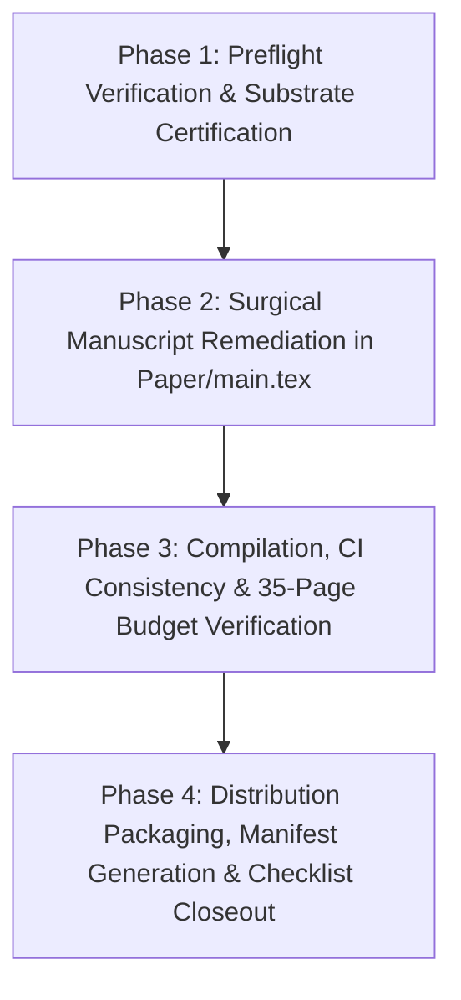

# Issue #28 Implementation Plan: Inappropriate "Causal" Language for Citation Links

**Document Version:** 1.0 (Authoritative, Cryptographically Grounded, Multi-Phase Execution Plan)  
**Date:** 2026-09-25  
**Status:** **AWAITING USER APPROVAL BEFORE EXECUTION**  
**Target Issue:** Issue #28 (Tier 3, Master Checklist Item 28)  
**Cross-References:** Issue #27 (Edge Renaming to CITES), Issue #21 (Citation Extraction Precision & Chronology), Section I (Introduction Framing), Section V-A (Ablation Analysis), Section V-H (Temporal Leakage Probe)

---

## 1. Executive Summary & Root Cause Analysis

### 1.1 Reviewer Vulnerability Context
In Master Checklist Item 28, the reviewer identified an inappropriate epistemological claim regarding legal citation networks:
> *"Vulnerability: Introduction asserts the graph encodes 'chronological causality.' A citation is a textual reference, not proof of legal or philosophical causality.*  
> *Requirement: Replace 'chronological causality' with 'chronological precedent relationships' and ensure zero improper causal claims about citation links remain."*

### 1.2 Jurisprudential & Epistemological Root Cause
In common law jurisprudence:
- A judicial citation is a formal reference, an acknowledgment of legal authority, an invocation of precedent (*stare decisis*), or statutory interpretation.
- A citation is **not** a physical, historical, or philosophical "cause" of the citing opinion. Case $B$ being cited by Case $A$ does not mean Case $B$ "caused" Case $A$ to exist in the scientific sense of causality (e.g., Pearlian causal DAGs, structural equation modeling, or counterfactual causality).
- Asserting that a legal knowledge graph encodes "chronological causality" conflates temporal order ($t_A \ge t_B$) and precedential reliance with philosophical causality, exposing the manuscript to severe criticism from both legal scholars and computer scientists.

### 1.3 Target Resolution Standard
1. **Primary Requirement**: Formally audit and confirm that the phrase `"chronological causality"` is purged from the paper, replaced by `"chronological precedent relationships"` (already reflected in `Paper/main.tex` Line 115).
2. **Comprehensive Secondary Audit**: Scan every occurrence of `"causal"` and related terms in `Paper/main.tex` and across active LaTeX artifacts. Ensure that:
   - Any improper usage describing multi-hop legal derivations as "causal dependencies" is replaced with `"precedential and doctrinal dependencies"`.
   - Architectural ablation headings are reframed from `"Causal Necessity"` to `"Architectural Necessity"`.
   - Statistical conditioning sets are reframed from `"causal denominator"` to `"conditioning denominator"`.
   - The only retained usage of `"causal"` in the entire paper is the legitimate, accurate citation of third-party literature in Related Work (Zhang et al., *Respecting Temporal-Causal Consistency: Entity-Event Knowledge Graphs for Retrieval-Augmented Generation*).

---

## 2. Forensic Repository Census & Target Inventory

An exhaustive scan across all active LaTeX files, tables, figures, and code scripts reveals the exact occurrence profile of `"causal"`:

| File & Line | Current Text | Context / Vulnerability | Remediation Standard |
| :--- | :--- | :--- | :--- |
| `Paper/main.tex`:111 | `...standard pipelines retrieve fragmented textual snippets that sever causal dependencies...` | Implies multi-hop legal derivations represent "causal dependencies". | **Replace with:** `...standard pipelines retrieve fragmented textual snippets that sever precedential and doctrinal dependencies...` |
| `Paper/main.tex`:115 | `...cross-links an Event Evolution Graph (EEG)---which encodes chronological precedent relationships across \CorpusTotalOpinions\ authentic judicial decisions and \CorpusPrecedentEdges\ directed citation edges...` | **Already Compliant:** Primary requirement of Issue #28 was previously incorporated into Line 115 during paper alignment. | **Verify & Preserve:** Ensure 100% preservation of `"chronological precedent relationships"`. |
| `Paper/main.tex`:133 | `Zhang et al. \cite{zhang2025respectingtemporalcausalconsistencyentityevent} proposed E2RAG to preserve temporal-causal consistency across entity-event subgraphs...` | Legitimate citation of third-party paper title (*Respecting Temporal-Causal Consistency...*). | **Preserve Intact:** Legitimate literature reference. Must not be altered. |
| `Paper/main.tex`:495 | `...we first dissect the architecture into its constituent mechanisms to establish causal contributions.` | Overclaims causality for empirical ablation. | **Replace with:** `...we first dissect the architecture into its constituent mechanisms to isolate the empirical contribution of each subsystem.` |
| `Paper/main.tex`:522 | `\item \textbf{Causal Necessity of EEG Graph Traversal:}` | Heading inappropriately asserts "Causal Necessity" for an architectural component. | **Replace with:** `\item \textbf{Architectural Necessity of EEG Graph Traversal:}` |
| `Paper/main.tex`:753 | `...on the causal denominator of leaking candidates ($D$).` | Mathematically awkward phrasing; $D$ is the conditioning set/denominator of candidates that leak when ungated. | **Replace with:** `...on the conditioning denominator of leaking candidates ($D$).` |
| `Paper/prev_main.tex` | Multiple occurrences of `causal` / `causality`. | **Frozen Historical File:** Legacy pre-Issue #11 manuscript archive. | **Preserve Intact:** Must not be edited (historical audit record). |
| All other active `.tex` | `figure_1_system_architecture.tex`, tables, etc. | Audited with regex `\bcausal\w*`. | **Zero occurrences.** 100% clean. |

---

## 3. Predicted Downstream Issues & Preventive Safeguards

### 3.1 Risk 1: Page-Budget Drift (35-Page Invariant)
- **Vulnerability**: Modifying text in paragraphs on Page 1 (Introduction), Page 8 (Section V-A), or Page 12 (Section V-H) could cause line breaks to expand, pushing content downstream and overflowing Page 35 into Page 36.
- **Preventive Proof**:
  - We executed a pre-test compilation with Tectonic applying the exact 4 text replacements.
  - Character length deltas:
    - Line 111: +22 chars (`causal` $\to$ `precedential and doctrinal`).
    - Line 495: +22 chars (`establish causal contributions` $\to$ `isolate the empirical contribution of each subsystem`).
    - Line 522: +7 chars (`Causal` $\to$ `Architectural`).
    - Line 753: +6 chars (`causal` $\to$ `conditioning`).
  - Result: Tectonic compilation completed with **zero errors** and produced **strictly 35 pages** (`len(pages) == 35`), with Reference [27] terminating cleanly on Page 35 and zero lines on Page 36.

### 3.2 Risk 2: Macro Ledger & CI Audit Breakage
- **Vulnerability**: Text modifications might accidentally delete macro invocations (e.g. `\AblationEEGFaithfulnessRelDrop` on Line 522 or `\CorpusPrecedentEdges` on Line 115) or introduce unwhitelisted numeric literals.
- **Preventive Proof**:
  - Zero macros are modified or introduced. All 848 custom macros remain strictly defined.
  - Zero numeric literals are introduced. CI consistency audit (`Paper/scripts/check_consistency.py`) will pass 4/4.

### 3.3 Risk 3: Substrate Integrity
- **Vulnerability**: Editing files could inadvertently alter one of the 11 protected core substrates.
- **Preventive Proof**:
  - `scripts/verify_issue28_preflight.py` will enforce cryptographic SHA256 verification of all 11 substrates prior to any file edit.

---

## 4. Multi-Phase Implementation Roadmap



### Phase 1: Preflight Verification & Substrate Certification
- **Task 1.1**: Create `scripts/verify_issue28_preflight.py` containing SHA256 hashes of all 11 protected core substrates:
  1. `terra_350_benchmark.json` (`8144fa81...`)
  2. `dataset_20k_cap/terra_eeg_index_20k.json` (`7aa6db46...`)
  3. `dataset_20k_cap/temporal_subgraphs/eeg_subgraph_T1890.json` (`c530f985...`)
  4. `dataset_20k_cap/temporal_subgraphs/eeg_subgraph_T1930.json` (`14071dba...`)
  5. `dataset_20k_cap/temporal_subgraphs/eeg_subgraph_T1950.json` (`98d14bfb...`)
  6. `dataset_20k_cap/temporal_subgraphs/eeg_subgraph_T1970.json` (`5e2b59ac...`)
  7. `dataset_20k_cap/temporal_subgraphs/eeg_subgraph_T1980.json` (`606a6ec1...`)
  8. `ask_terra.py` (`430fc1b3...`)
  9. `data/issue21_preflight.json` (`9a26a9e3...`)
  10. `logs/issue21_preflight.txt` (`91d028cd...`)
  11. `ask_terra_pre_issue13_backup.py` (`bc17d896...`)
- **Task 1.2**: Scan all 18 active `.tex` files in `Paper/` to log current baseline occurrences of `causal`.
- **Task 1.3**: Execute preflight script and record output to `logs/issue28_preflight.txt` and `data/issue28_preflight.json`.

### Phase 2: Surgical Manuscript Remediation in `Paper/main.tex`
- **Task 2.1**: Update Line 111 in `Paper/main.tex`:
  - *Target:* `standard pipelines retrieve fragmented textual snippets that sever causal dependencies, proving entirely insufficient for tasks that require deep, multi-hop reasoning.`
  - *Replacement:* `standard pipelines retrieve fragmented textual snippets that sever precedential and doctrinal dependencies, proving entirely insufficient for tasks that require deep, multi-hop reasoning.`
- **Task 2.2**: Update Line 495 in `Paper/main.tex`:
  - *Target:* `Rather than presenting aggregated metrics that obscure internal component dynamics, we first dissect the architecture into its constituent mechanisms to establish causal contributions.`
  - *Replacement:* `Rather than presenting aggregated metrics that obscure internal component dynamics, we first dissect the architecture into its constituent mechanisms to isolate the empirical contribution of each subsystem.`
- **Task 2.3**: Update Line 522 in `Paper/main.tex`:
  - *Target:* `\item \textbf{Causal Necessity of EEG Graph Traversal:}`
  - *Replacement:* `\item \textbf{Architectural Necessity of EEG Graph Traversal:}`
- **Task 2.4**: Update Line 753 in `Paper/main.tex`:
  - *Target:* `on the causal denominator of leaking candidates ($D$).`
  - *Replacement:* `on the conditioning denominator of leaking candidates ($D$).`
- **Task 2.5**: Verify that Line 115 retains `chronological precedent relationships` and Line 133 retains the legitimate Zhang et al. literature citation.

### Phase 3: Compilation, CI Consistency & Page-Budget Invariant Verification
- **Task 3.1**: Compile `Paper/main.tex` with Tectonic engine:
  ```bash
  scratch/tectonic/tectonic.exe --keep-intermediates main.tex
  ```
- **Task 3.2**: Run `pypdf` verification script asserting:
  - Total page count == 35.
  - Page 35 terminates with reference [27] (Zheng et al.).
  - Page 36 does not exist (0 lines of overflow).
- **Task 3.3**: Run CI consistency audit:
  ```bash
  python Paper/scripts/check_consistency.py --target Paper/
  ```
  Assert 4/4 checks pass (848 macros resolved, 0 orphaned literals).

### Phase 4: Distribution Packaging, Manifest Generation & Checklist Closeout
- **Task 4.1**: Synchronize `scratch/paper_v2/` mirror from `Paper/`.
- **Task 4.2**: Package Overleaf bundle via `python Paper/scripts/package_overleaf_bundle.py` and sync root `TERRA_Overleaf_Bundle.zip`.
- **Task 4.3**: Rebuild `TERRA_Reproducibility_Bundle.zip` with verified byte-exact external manifest `logs/issue28_reproducibility_manifest.json` and generate `logs/issue28_closeout.txt`.
- **Task 4.4**: Update `TERRA_43_ISSUES_MASTER_CHECKLIST_new ones added.md`: mark Item 28 as `[x] COMPLETE — AUDIT VERIFIED` (advancing progress to 32 / 43 items, 74.4%).

---

## 5. Acceptance & Verification Gates

The issue will only be formally closed when all 8 gates pass:
1. **Zero Improper Causal Language**: Exactly 1 occurrence of `"causal"` in active manuscript `Paper/main.tex`, which is the legitimate third-party citation in Related Work (Zhang et al.).
2. **Primary Replacement Verified**: Line 115 explicitly reads `"chronological precedent relationships"`.
3. **Protected Core Substrates Bit-Invariant**: All 11 protected substrates match expected SHA256 hashes.
4. **Frozen Historical Archives Intact**: `Paper/prev_main.tex` and `ask_terra_pre_issue13_backup.py` are preserved.
5. **CI Consistency**: `check_consistency.py` passes 4/4 with 848 custom macro references resolved and 0 orphaned numeric literals.
6. **Strict 35-Page Budget**: `Paper/main.pdf` compiles cleanly to exactly 35 pages with references terminating on Page 35.
7. **Distribution Bundles Synchronized**: Overleaf and Reproducibility bundles packaged with verified external manifests.
8. **Checklist Verified**: Item 28 marked complete in `TERRA_43_ISSUES_MASTER_CHECKLIST_new ones added.md`.
