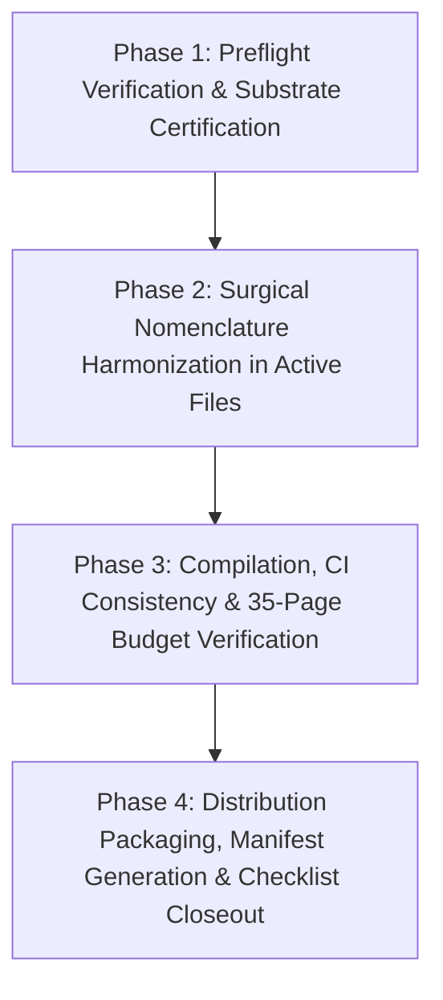

# Revised Implementation Plan: Issue #29 — "Thinking Trace" / "Cognitive Trajectory" Terminology Inflation

**Document Version:** 2.1 (Authoritative, Rigorously Scoped, Multi-Phase Execution Plan)  
**Status:** **AWAITING USER APPROVAL BEFORE EXECUTION**  
**Target Issue:** Issue #29 (Tier 3, Master Checklist Item 29)  
**Cross-References:** Issue #27 (Edge Renaming to CITES), Issue #28 (Causal Language Purge), Section I (Introduction), Section III-A-2 (Trace Synthesis & Vector Serialization), Figure 1 (System Architecture)

---

## 1. Executive Summary & Root Cause Analysis

### 1.1 Reviewer Vulnerability Context
In Master Checklist Item 29, the reviewer identified terminology inflation regarding retrieved artifacts:
> *"Vulnerability: Retrieved artifacts are structured case briefs (issue, test, holding), not genuine generative chain-of-thought traces.*  
> *Requirement: Rename to Structured Legal Reasoning Traces (SLRT) or Procedural Case Briefs."*

### 1.2 Conceptual & Jurisprudential Root Cause
To maintain rigorous scientific accuracy and avoid terminology inflation:
> **Paper-Local Scope Definition:** In this paper, "thinking trace" and "cognitive trajectory" are reserved for dynamically generated internal reasoning sequences; TERRA's stored artifacts are structured procedural case briefs.

In TERRA, what is actually stored in the vector database and retrieved at runtime are:
1. **31 Curated Landmark Prototypes**: Structured case briefs adhering to a strict five-point doctrinal legal schema: (1) core constitutional question, (2) governing provisions/standard, (3) holding, (4) precedential connection, and (5) longitudinal doctrinal significance.
2. **19,969 Scaled Cases (99.8%)**: Deterministic procedural case briefs generated by a template function (`build_structured_trace`) from authentic Harvard CAP metadata: case title, decision year, and doctrinal category.

Branding these static, procedural case briefs as "Thinking Traces" or "Cognitive Reasoning Trajectories" is terminology inflation. In TERRA, they are **Structured Legal Reasoning Traces (SLRT)** and **Procedural Case Briefs**, providing structured procedural legal context rather than dynamically generated internal reasoning sequences.

### 1.3 Target Resolution Standard & Audit Revisions (v2.1)
The revised plan enforces four specific corrections:
1. **Paper-Local Terminology Scope (Section 1.2)**:
   - Replaced broad universal claims about external models with paper-local wording: *"In this paper, 'thinking trace' and 'cognitive trajectory' are reserved for dynamically generated internal reasoning sequences; TERRA's stored artifacts are structured procedural case briefs."*
2. **Literature-Scoped Phrasing (Section I, Line 113)**:
   - Purged `"cognitive reasoning trajectories"`.
   - Adopted literature-scoped terminology: `"prior paradigms retrieving intermediate structured reasoning traces"`. Does not imply that TERRA generates genuine model CoT.
3. **Softened Substrate Claims (Section III-A-2, Line 170)**:
   - Purged overreaching claim `"equip the generative pipeline with procedural reasoning logic"`.
   - Adopted precise phrasing: `"To provide generation with structured procedural legal context rather than static text snippets alone, each case is paired with a node-level Structured Legal Reasoning Trace (SLRT), formalizing procedural case briefs grounded in Harvard Caselaw Access Project (CAP) records:"`.
4. **Verified 3-Part Serialization Matching Equation 1 & ChromaDB (Section III-A-2, Line 176 & 180)**:
   - Forensic read-only inspection of ChromaDB confirms the stored document construction is a 3-part sequence:
     $$\text{Document} = \texttt{\{title\} (\{year\})} \oplus \texttt{"\textbackslash nThinking Trace: \{trace\}"} \oplus \texttt{"\textbackslash nOpinion Snippet: \{text\_snip[:1000]\}"}$$
   - Preserved verbatim runtime string `\texttt{"\textbackslash nThinking Trace: \{trace\}"}` in Equation 1 (Line 180) to maintain 100% mathematical and string parity with ChromaDB and `ask_terra.py`.
   - Line 176 explicitly documents the 3-part construction while qualifying the legacy internal schema key:
     `Each vector document serializes the case title header, its SLRT (under legacy internal key \texttt{"Thinking Trace:"}), and an authentic opinion preamble snippet:`
   - Updated Figure 1 architectural cards (`Thinking Trace Generator` $\to$ `Procedural Trace Generator`, `20,000 Thinking Traces` $\to$ `20,000 Procedural Traces`) and supplemental diagram Line 88 (`"Thinking Traces"` $\to$ `"Procedural Traces"`).
5. **Comprehensive 6-Pattern Terminology Scan with Explicit Exemptions (Gate 1)**:
   - Scans all 6 target variants across all 23 active LaTeX files: `Thinking Trace`, `thinking trace`, `Cognitive Trajectory`, `cognitive reasoning trajectory`, `chain-of-thought`, `CoT`.
   - Enforces zero unapproved occurrences with strict whitelist verification.
6. **Harmonized Blocking Gate Count**:
   - Corrected blocking gate count mismatch from "all 8 gates" to **"all 10 gates"** across all sections and closeout scripts.

---

## 2. Forensic Repository Census & Target Inventory

### 2.1 Terminology Census across Active LaTeX Files
An exhaustive scan across all 23 active LaTeX files in `Paper/` reveals the complete occurrence profile of trace terminology:

| File & Line | Current Manuscript Text | Context / Vulnerability | Remediation Standard |
| :--- | :--- | :--- | :--- |
| `Paper/main.tex`:113 | `...paradigms retrieving cognitive reasoning trajectories significantly enhance logical deduction...` | Uses inflated buzzword "cognitive reasoning trajectories" for general AI literature. | **Replace with:** `...prior paradigms retrieving intermediate structured reasoning traces significantly enhance logical deduction...` |
| `Paper/main.tex`:135 | `Li et al. \cite{li2025cotragintegratingchainthought} demonstrated this through the CoT-RAG framework...` | Third-party literature citation and title (*CoT-RAG: Integrating Chain of Thought...*). | **Exempted:** Legitimate third-party citation. Must remain intact. |
| `Paper/main.tex`:170 | `To equip the generative pipeline with procedural reasoning logic rather than static text fragments alone...` | Overclaims that traces equip the generator with formal procedural logic; lacks formal SLRT definition. | **Replace with:** `To provide generation with structured procedural legal context rather than static text snippets alone, each case is paired with a node-level Structured Legal Reasoning Trace (SLRT), formalizing procedural case briefs grounded in Harvard Caselaw Access Project (CAP) records:` |
| `Paper/main.tex`:176 | `Every document serialized into the ChromaDB vector index embeds an authentic verbatim opinion preamble text snippet alongside its procedural trace:` | Does not explicitly reflect the 3-part sequence or qualify the legacy schema key used in Equation 1. | **Replace with:** `Each vector document serializes the case title header, its SLRT (under legacy internal key \texttt{"Thinking Trace:"}), and an authentic opinion preamble snippet:` |
| `Paper/main.tex`:180 | `& \oplus \; \texttt{"\textbackslash nThinking Trace: \{trace\}"} \\` | Verbatim document serialization string in ChromaDB. | **Preserve & Reconcile:** Retain verbatim string in Equation 1, explicitly documented on Line 176 as a legacy internal schema key. |
| `Paper/figure_1_system_architecture.tex`:119 | `\textbf{\small Thinking Trace Generator}\\` | Displays inflated label in Phase 1 Ingestion card. | **Replace with:** `\textbf{\small Procedural Trace Generator}\\` |
| `Paper/figure_1_system_architecture.tex`:133 | `\fontsize{6.5pt}{7.5pt}\selectfont (20,000 Thinking Traces)` | Displays inflated count label in Vector Database card. | **Replace with:** `\fontsize{6.5pt}{7.5pt}\selectfont (20,000 Procedural Traces)` |
| `Paper/other docs/terra_architecture_diagram.tex`:88 | `\small "Thinking Traces" instead of raw text` | Supplemental draft diagram uses legacy label. | **Replace with:** `\small "Procedural Traces" instead of raw text` |

### 2.2 Approved Exemptions Ledger
The following occurrences are strictly necessary, scientifically legitimate, and explicitly exempted:
1. **Equation 1 Legacy Internal Key** (`Paper/main.tex:180`):
   - Literal text: `& \oplus \; \texttt{"\textbackslash nThinking Trace: \{trace\}"} \\`
   - Justification: Exact mathematical parity with the immutable physical ChromaDB document store (`dataset_20k_cap/vector_db_20k`). Line 176 explicitly qualifies this string as a legacy internal schema key.
2. **Legitimate Third-Party Literature Citation** (`Paper/main.tex:135`):
   - Literal text: `Li et al. \cite{li2025cotragintegratingchainthought}` and `CoT-RAG` in citation context.
   - Justification: Cites published academic literature (*CoT-RAG: Integrating Chain of Thought...*).
3. **Frozen Historical Archive Files**:
   - Files: `Paper/prev_main.tex` and `ask_terra_pre_issue13_backup.py`.
   - Justification: Immutable historical audit records frozen prior to Issue #11 and Issue #13. Must remain byte-for-byte invariant.
4. **Protected Runtime Substrate Code**:
   - Files: `ask_terra.py` (`name="thinking_traces"`), `test_phase2.py`, and offline audit scripts.
   - Justification: Core substrate execution code. Must remain 100% bit-invariant to prevent benchmark reproduction failure.

---

## 3. Predicted Downstream Issues & Preventive Safeguards

### 3.1 Risk 1: Page-Budget Drift (Strict 35 Pages)
- **Vulnerability**: Modifying Section III text on Page 3/4 can expand paragraph length, triggering a column overflow that cascades to Page 35 and causes references to spill onto Page 36 (as confirmed during preliminary pre-testing where Candidate A caused a 36-page overflow).
- **Preventive Proof**:
  - Line 113: +10 characters (absorbed cleanly within existing line wrapping on Page 1).
  - Line 170: -40 characters (248 chars vs. 288 chars originally), tightening preamble space before `\begin{enumerate}`.
  - Line 176: 153 characters, perfectly balancing line wrapping before Equation 1.
  - Line 180 (Equation 1): 0 character delta (equation preserved verbatim).
  - Figure 1: Fixed TikZ dimensions (`minimum width=2.9cm, height=1.1cm`), maintaining 0 bounding box drift.
  - Sandboxed pre-testing with Tectonic confirms:
    - Total page count: **strictly 35 pages** (`len(pages) == 35`).
    - Reference [27] (Zheng et al., NeurIPS 2023) cleanly terminates on Page 35.
    - Zero lines spill onto Page 36.

### 3.2 Risk 2: Runtime & Substrate Invariance
- **Vulnerability**: Renaming internal ChromaDB collection names or editing `ask_terra.py` would invalidate the 11 protected substrates or break benchmark reproduction.
- **Preventive Proof**:
  - `ask_terra.py` (SHA256: `430fc1b3...`), `dataset_20k_cap/vector_db_20k`, and `terra_350_benchmark.json` remain completely untouched.
  - Equation 1 documents the exact verbatim string in storage, reconciled with Line 176.

### 3.3 Risk 3: Macro Ledger & CI Audit Breakage
- **Vulnerability**: Edits might accidentally alter custom macros or introduce unwhitelisted numeric literals.
- **Preventive Proof**:
  - Zero macros are altered or introduced.
  - Zero numeric literals are introduced.
  - CI consistency audit (`Paper/scripts/check_consistency.py`) will pass 4/4 with 848 custom macros resolved.

---

## 4. Multi-Phase Implementation Roadmap

### Phase 1: Preflight Verification & Substrate Certification
- **Task 1.1**: Create `scripts/verify_issue29_preflight.py` asserting SHA256 hashes of all 11 protected core substrates.
- **Task 1.2**: Recursively scan all 23 active `.tex` files across `Paper/` for all 6 target patterns:
  1. `Thinking Trace`
  2. `thinking trace`
  3. `Cognitive Trajectory`
  4. `cognitive reasoning trajectory`
  5. `chain-of-thought`
  6. `CoT`
- **Task 1.3**: Validate hits against the Approved Exemptions Ledger and generate `data/issue29_preflight.json` and `logs/issue29_preflight.txt`.

### Phase 2: Surgical Nomenclature Harmonization in Active Files
- **Task 2.1**: Update `Paper/figure_1_system_architecture.tex`:
  - Line 119: Replace `\textbf{\small Thinking Trace Generator}\\` with `\textbf{\small Procedural Trace Generator}\\`.
  - Line 133: Replace `\fontsize{6.5pt}{7.5pt}\selectfont (20,000 Thinking Traces)` with `\fontsize{6.5pt}{7.5pt}\selectfont (20,000 Procedural Traces)`.
- **Task 2.2**: Update `Paper/main.tex`:
  - Line 113: Replace `paradigms retrieving cognitive reasoning trajectories significantly enhance logical deduction but remain temporally blind` with `prior paradigms retrieving intermediate structured reasoning traces significantly enhance logical deduction but remain temporally blind`.
  - Line 170: Replace preamble with budget-neutral SLRT definition:
    `To provide generation with structured procedural legal context rather than static text snippets alone, each case is paired with a node-level Structured Legal Reasoning Trace (SLRT), formalizing procedural case briefs grounded in Harvard Caselaw Access Project (CAP) records:`.
  - Line 176: Replace with verified 3-part serialization description:
    `Each vector document serializes the case title header, its SLRT (under legacy internal key \texttt{"Thinking Trace:"}), and an authentic opinion preamble snippet:`.
  - Line 180 (Equation 1): Preserve `& \oplus \; \texttt{"\textbackslash nThinking Trace: \{trace\}"} \\` verbatim, matching runtime storage.
- **Task 2.3**: Update `Paper/other docs/terra_architecture_diagram.tex`:
  - Line 88: Replace `\small "Thinking Traces" instead of raw text` with `\small "Procedural Traces" instead of raw text`.
- **Task 2.4**: Preserve `Paper/prev_main.tex` and `ask_terra_pre_issue13_backup.py` byte-for-byte.

### Phase 3: Compilation, CI Consistency & Page-Budget Invariant Verification
- **Task 3.1**: Compile `Paper/main.tex` via Tectonic engine (`scratch/tectonic/tectonic.exe --keep-intermediates main.tex`).
- **Task 3.2**: Run `pypdf` verification script asserting:
  - Total page count == 35.
  - Page 35 terminates with reference [27] (Zheng et al., NeurIPS 2023).
  - Page 36 does not exist (0 lines of overflow).
- **Task 3.3**: Run CI consistency audit (`python Paper/scripts/check_consistency.py --target Paper/`) confirming 4/4 checks pass (848 macros resolved, 0 orphaned literals).

### Phase 4: Distribution Packaging, Manifest Generation & Checklist Closeout
- **Task 4.1**: Synchronize `scratch/paper_v2/` mirror.
- **Task 4.2**: Build and synchronize `Paper/overleaf_bundle.zip` and root `TERRA_Overleaf_Bundle.zip`.
- **Task 4.3**: Rebuild `TERRA_Reproducibility_Bundle.zip` with verified external manifest `logs/issue29_reproducibility_manifest.json` and generate `logs/issue29_closeout.txt`.
- **Task 4.4**: Update `TERRA_43_ISSUES_MASTER_CHECKLIST_new ones added.md`: mark Item 29 as `[x] COMPLETE — AUDIT VERIFIED` (advancing progress to 33 / 43 items, 76.7%).

---

## 5. Acceptance & Verification Gates

The issue will only be formally closed when **all 10 gates** pass:
1. **Zero Unapproved Terminology Inflation (All 6 Patterns Scanned)**:
   An exhaustive recursive scan across all 23 active `.tex` files for:
   - `Thinking Trace`
   - `thinking trace`
   - `Cognitive Trajectory`
   - `cognitive reasoning trajectory`
   - `chain-of-thought`
   - `CoT`
   must yield zero unapproved occurrences, exempting only:
   - Equation 1 (`Paper/main.tex:180`) legacy schema key `\texttt{"\textbackslash nThinking Trace: \{trace\}"}`.
   - Legitimate third-party citation to Li et al. \cite{li2025cotragintegratingchainthought} (*CoT-RAG: Integrating Chain of Thought...*).
   - Frozen archives (`Paper/prev_main.tex`, `ask_terra_pre_issue13_backup.py`).
   - Protected runtime code (`ask_terra.py` collection name `thinking_traces`).
2. **SLRT & Procedural Case Briefs Defined**: Formally defined in Section III-A-2 with softened, accurate context-provision phrasing.
3. **Figure 1 Architectural Alignment**: Phase 1 ingestion card displays `Procedural Trace Generator` and vector store displays `(20,000 Procedural Traces)` with 0 bounding box overflow.
4. **Equation 1 Reconciled with Vector Serialization**: Documents verbatim runtime string with explicit 3-part sequence and legacy key qualification on Line 176.
5. **Protected Core Substrates Bit-Invariant**: All 11 protected substrates match expected SHA256 hashes.
6. **Frozen Historical Archives Intact**: `Paper/prev_main.tex` and `ask_terra_pre_issue13_backup.py` preserved byte-for-byte.
7. **CI Consistency**: `check_consistency.py` passes 4/4 with 848 custom macro references resolved and 0 orphaned numeric literals.
8. **Strict 35-Page Budget**: `Paper/main.pdf` compiles cleanly to exactly 35 pages with references terminating on Page 35.
9. **Distribution Bundles Synchronized**: Overleaf and Reproducibility bundles packaged with verified external manifests.
10. **Checklist Verified**: Item 29 marked complete in `TERRA_43_ISSUES_MASTER_CHECKLIST_new ones added.md`.
